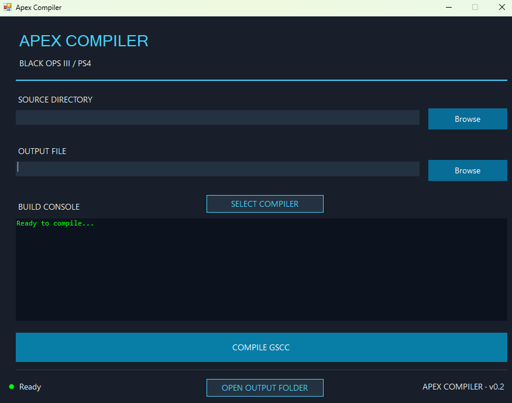

# APEX DevTools

**A PlayStation 4 Black Ops III GSC compilation toolkit featuring a standalone command-line compiler and a custom Windows GUI.**

APEX DevTools provides a streamlined way to compile `.gsc` source files into `.gscc` files for Call of Duty: Black Ops III on PlayStation 4.



Built using C# and .NET Framework 4.8.

## Features

### APEX Compiler (CLI)
- GSC to GSCC compilation
- PS4 BO3 1.33 opcode support
- Command-line operation
- Suitable for scripting and automated build workflows

### APEX Compiler GUI
- Custom dark-themed Windows Forms interface
- Source directory and output file selection
- One-click GSCC compilation
- Coloured compilation logs
- Real-time compilation status indicators
- Persistent source and output paths
- Configurable compiler executable location
- Open compiled output directly in File Explorer

The compiler and GUI are maintained in one Visual Studio solution but can be used independently.

---

## Downloads

Download the latest version from [GitHub Releases](../../releases/latest).

| Package | Description |
|---|---|
| APEX Compiler CLI | Command-line compiler only |
| APEX Compiler GUI | Graphical interface; requires the CLI separately |
| APEX Compiler Bundle | GUI and CLI together — recommended |

### System requirements

- Windows
- .NET Framework 4.8
- Compatible PS4 BO3 1.33 environment for testing compiled scripts

## Installation

### Recommended — Bundle

1. Download `APEX-Compiler-Bundle-v1.0.0.zip`.
2. Extract the ZIP to a folder of your choice.
3. Launch `APEX.Compiler.GUI.exe`.
4. Select your GSC source directory.
5. Select your desired GSCC output location.
6. Click **COMPILE GSCC**.

The GUI automatically detects the compiler when both executables are in the same directory, unless a valid custom compiler path is configured.

### GUI only

Download and extract `APEX-Compiler-GUI-v1.0.0.zip`.

Launch the GUI, click **SELECT COMPILER**, and select an existing compatible `APEX.Compiler.exe`.

### Command-line usage

Download and extract `APEX-Compiler-CLI-v1.0.0.zip`.

Open PowerShell in the compiler directory and execute:

```powershell
.\APEX.Compiler.exe "C:\Path\To\GSC-Source" "C:\Path\To\APEX.gscc"
```

Keep `Irony.dll` and `apex_ps4_ops.bin` alongside the compiler executable.

---

## Building from source

1. Clone or download this repository.
2. Open `APEX.DevTools.sln` in Visual Studio Community.
3. Ensure the .NET Framework 4.8 targeting pack is installed.
4. Restore NuGet packages when prompted.
5. Select **Release | Any CPU**.
6. Select **Build → Build Solution**.

The solution contains two independent projects:

```text
APEX.DevTools.sln
├── src/
│   ├── APEX.Compiler/
│   └── APEX.Compiler.GUI/
├── samples/
├── scripts/
│   └── package.ps1
├── README.md
└── CREDITS_AND_RIGHTS.md
```

## Packaging releases

After successfully building both projects, open PowerShell in the repository root.

```powershell
.\scripts\package.ps1 -Version "1.0.0"
```

This generates three distribution archives inside `artifacts/`:

```text
APEX-Compiler-CLI-v1.0.0.zip
APEX-Compiler-GUI-v1.0.0.zip
APEX-Compiler-Bundle-v1.0.0.zip
```

Each package can be distributed separately.

## Compatibility and limitations

- Designed for PS4 BO3 version 1.33.
- Compilation does not guarantee successful execution in-game.
- No PS4 injector or console payload is included.
- Other game versions have not been validated.
- The combined solution and distribution packages have been tested by the developer on Windows.

## Credits

APEX DevTools builds upon earlier community work, including:

- [shiversoftdev/t7-compiler](https://github.com/shiversoftdev/t7-compiler)
- [someguythatmods/ps4-bo3-gsc-injector](https://github.com/someguythatmods/ps4-bo3-gsc-injector)

See [CREDITS_AND_RIGHTS.md](CREDITS_AND_RIGHTS.md) for attribution and redistribution information.

## Disclaimer

APEX DevTools is an independent community project and is not affiliated with, endorsed by, or sponsored by Activision, Treyarch, or Sony Interactive Entertainment.

Call of Duty and Black Ops are trademarks of their respective owners.
